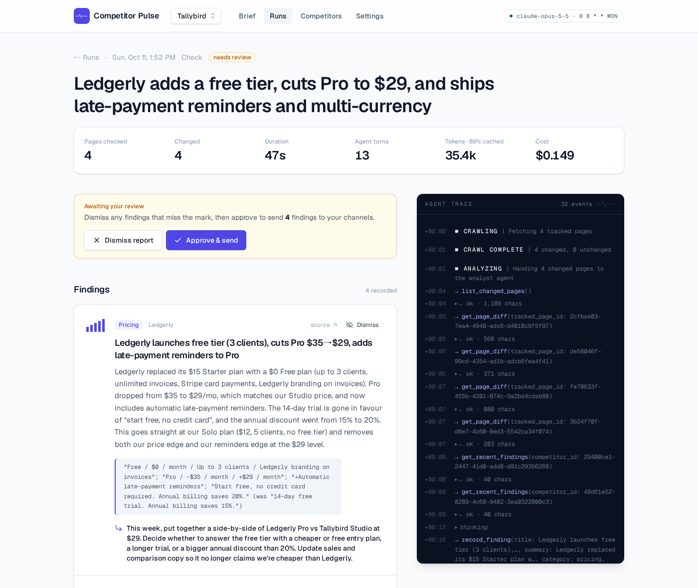

# Competitor Pulse

**An AI analyst that watches your competitors' websites and tells you what changed and why it matters to *your* business.**

Setup is one field: your website. A discovery agent reads your site, writes your company profile and suggests your direct competitors. You approve the shortlist, and it finds the pages worth watching on each competitor.

Every week (or whenever you click *Run check now*), Competitor Pulse re-reads the pricing pages, changelogs, homepages and careers pages you track. When something changes, an analyst built on the [Claude Agent SDK](https://code.claude.com/docs/en/agent-sdk/overview) reads the diffs, checks what it has already reported, scores each change against your company profile, and writes a brief. You review it, dismiss anything off-base, and approve. Only then does it go to Slack or email.

> "Ledgerly cut Pro to $29 and added automatic payment reminders, our main differentiator. Consider leading the next campaign with multi-currency, which they still lack."

It only pays for real changes: a week where nothing changed costs $0, and the sample run below (2 competitors, 4 changed pages, 4 findings) cost $0.15.



## Agent functionality

Three agents built on the Claude Agent SDK do the parts that need judgment. Everything else (crawling, change detection, the job queue, notifications) is ordinary code. The full walkthrough is in [How the agents work](docs/agents.md).

**Company discovery** starts from your website URL. It reads your site in a real browser (comparison and "alternatives" pages first), writes a company profile, and searches the web for direct competitors. It decides who counts as a direct competitor and suggests up to three, each with a one-line reason. Nothing is tracked until you approve the shortlist. [Prompt](backend/app/agent/discovery/prompts.py) · [Tools](backend/app/agent/discovery/tools.py)

**Page discovery** starts from one competitor's homepage, either from the approved shortlist or one you add by hand. It follows the site's navigation, decides which pages carry strategic signal (pricing, changelog, homepage, careers), and starts tracking the top three, each with a reason. Every URL is loaded before it is accepted, so a made-up link is rejected. [Prompt](backend/app/agent/discovery/prompts.py) · [Tools](backend/app/agent/discovery/tools.py)

**Analyst** starts from the pages whose text changed since the last check. It reads each diff (and the full page when a diff is ambiguous), checks what it already reported about that competitor, and may run a web search for context. It decides what is noise and what matters, scores each finding 1–5 against your company profile with a verbatim quote as evidence, and writes a short brief. The run stops for your review; only approved findings go to Slack or email. [Prompt](backend/app/agent/analyst/prompts.py) · [Tools](backend/app/agent/analyst/tools.py)

What all three share:

- **Tools scoped to one job.** Each agent gets a few purpose-built MCP tools bound to a single run or competitor; everything else is denied. ([analyst tools](backend/app/agent/analyst/tools.py))
- **Bad input is explained, not raised.** Tools reject invalid input with a plain-language reason ("That's the company's own website"), and the agent corrects itself. ([tool results](backend/app/agent/tool_results.py))
- **No model call unless something changed.** A deterministic crawl and diff runs first; unchanged pages and first captures never reach the model. ([check pipeline](backend/app/worker/check.py))
- **Everything is traced.** Every thought, tool call and result is saved and streamed to the UI live, with tokens, cache hits, turns and cost per run. ([tracing](backend/app/agent/tracing.py))
- **Hard limits.** A per-run budget and turn cap, a configurable model and effort, and caps on competitors and pages. ([runner](backend/app/agent/runner.py), [config](backend/app/config.py))
- **Isolated and injection-aware.** Agents run in a throwaway directory with no shell or file access, treat page text as data rather than instructions, and the analyst can't reach arbitrary URLs. See the [security model](docs/agents.md#security-model).
- **Evaluated.** `make eval` runs the real agents on fixed cases, including prompt-injection attempts. See the [latest results](docs/evals.md). ([eval runner](backend/evals/run.py))

**Use it from your own agent.** The API also serves an [MCP server](docs/mcp.md), so Claude Code or Claude Desktop can ask *"what did our competitors change on pricing this month?"*, queue a check or edit the watchlist. Publishing stays with a person in the UI.

## Architecture

```
            ┌──────────────┐  cron / "Run now"   ┌────────────────────────────────────────┐
 React UI ─▶│  FastAPI     │── insert run ──────▶│ Postgres (runs = queue, snapshots,     │
  (live     │  /api/v1 /mcp│◀── trace, findings ─│  findings, run_events)                 │
  trace)    └──────────────┘                     └───────────────┬────────────────────────┘
                                                                 │ claim (SKIP LOCKED)
                                                       ┌─────────▼─────────┐
                                                       │      Worker       │
                                                       │ 1. Playwright     │──▶ competitor sites
                                                       │ 2. normalize+diff │
                                                       │ 3. Claude Agent   │──▶ Claude API
                                                       │    SDK + MCP tools│    (+ web search)
                                                       └─────────┬─────────┘
                                                                 ▼
                                               awaiting_review ──approve──▶ Slack / email
```

Postgres doubles as the job queue (`SELECT … FOR UPDATE SKIP LOCKED`), so there's no Redis or broker to run, and more workers can be added safely.

## Run it locally

Requirements: Docker and an [Anthropic API key](https://console.anthropic.com/).

```bash
git clone https://github.com/awwester/competitor-pulse.git
cd competitor-pulse
cp .env.example .env          # add ANTHROPIC_API_KEY
make dev                      # api, worker, frontend, postgres, mailpit, sample sites
```

Open http://localhost:5173 and enter your company website. Watch the discovery agent work, untick any competitors that don't belong (or add ones it missed), and approve. It then finds each competitor's pages and runs a first check to capture a baseline. From then on, checks run on `SCHEDULE_CRON` or whenever you click **Run check now**. Prefer to do it by hand? Write the profile in **Settings** and add competitors and pages yourself on **Competitors**.

Running more than one product? Pick **+ Add company** in the header switcher. Each company has its own profile, competitors, runs, spend and delivery settings, and scheduled checks run for all of them.

### Try it with sample data

To see a full cycle without waiting for a real competitor to change something, use the fictional company "Tallybird" and its two competitors, served locally by the `demo-sites` container. On a fresh install, enter this as your website:

```
http://demo-sites/tallybird/
```

The agent finds Ledgerly and Paperplane on Tallybird's comparison page; web search may suggest some real competitors too, so untick those to keep everything local. Approve, and once the first check has captured a baseline:

```bash
make demo-advance   # competitors "update" their sites
make run            # the analyst reviews the changes (queues a check for every company)
```

To skip discovery, `make seed` loads the same workspace instantly (then `make run` for the baseline).

Watch the trace stream in at http://localhost:5173. Add an email address under **Settings**, then click **Approve & send**, and the digest shows up in Mailpit at http://localhost:8025.

## Configuration

| Variable | Default | |
|---|---|---|
| `ANTHROPIC_API_KEY` | | Required by the worker |
| `AGENT_MODEL` | `claude-opus-5-5` | Any Claude model ID |
| `AGENT_EFFORT` | `medium` | `low` … `max` |
| `AGENT_MAX_BUDGET_USD` | `2.0` | Hard stop per run |
| `DISCOVERY_MAX_COMPETITORS` | `3` | Most competitors one discovery suggests |
| `DISCOVERY_MAX_PAGES` | `3` | Most pages tracked per competitor by discovery |
| `SCHEDULE_CRON` | `0 8 * * MON` | When scheduled runs fire (worker timezone) |
| `DEMO_MODE` | `false` | Read-only API for a public demo deployment |

Slack webhook and email recipients are set in the UI under **Settings**.

## Development

```bash
make test       # backend tests (no API calls)
make lint       # ruff + eslint
make eval       # analyst + discovery evals (real API, roughly $0.50); cases="a b" to pick
make help       # everything else
```

Project layout and conventions are in [CLAUDE.md](CLAUDE.md).

## Roadmap

- Auth and accounts (data is already scoped per company)
- Screenshot diffs alongside text diffs
- Hosted read-only demo

## License

MIT
