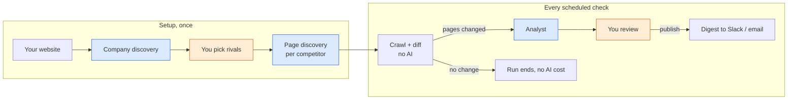

# How the Agents Work

Competitor Pulse uses three AI agents. Two of them set up monitoring from nothing but your website. The third reads what changed on competitor sites and decides what matters to you. A human approves the output at each point where it leaves the system or adds competitors.

| Agent | Job | Starts from | Produces | Human gate |
| --- | --- | --- | --- | --- |
| Company discovery | Understand your business and find your rivals | Your website URL | A company profile + 3–8 suggested competitors | You pick which suggestions to track |
| Page discovery | Pick which pages on one competitor's site to watch | One competitor's homepage | Up to 6 tracked pages, each with a reason | None; you can edit the list afterwards |
| Analyst | Judge which competitor changes matter | Pages whose text changed since the last check | Scored findings + a short report | You approve the report before it goes to Slack/email |

Everything else in the system is ordinary code: the crawler, the change detection, the job queue and the notifier. The agents are used only where the work needs judgment.

Blue boxes are agents, orange boxes are human approvals, and the rest is plain code.

## The discovery agents: setting up the watchlist

Together these turn a single URL into a working watchlist. You enter your website, approve some competitors, and monitoring starts.

### Company discovery

**Goal:** write a profile of your business and suggest who you compete with.

How it works, in the agent's own order:

1. Looks at what already exists: your website, any saved profile, competitors already tracked.
2. Reads your site in a real browser: homepage, then pricing, about, customers, and especially any "vs" or "alternatives" pages, which name competitors outright.
3. Saves a profile under 250 words: what you sell and to whom, plans and prices, where you win and where you're weak, which competitor moves you care about. An existing profile is never overwritten.
4. Searches the web ("<company> alternatives", G2/Capterra category pages) for direct competitors: companies selling a substitute to the same customer.
5. Suggests 3–8 of them, most direct first, each with a one-sentence reason ("Same freelancer segment; Starter plan $3 cheaper than ours").
6. Submits a one-line headline and stops.

**The human gate:** the suggestions wait in a review screen. You tick the ones you want and click apply. Only then do they become tracked competitors, and a page discovery run is queued for each one.

The profile matters beyond setup. The analyst reads it before every check, so it is how the system knows what "matters to your business" means.

### Page discovery

**Goal:** choose the few pages on one competitor's site that carry strategic signal.

1. Reads the competitor's record, its notes and your profile.
2. Reads the homepage and follows navigation and footer links to find candidates.
3. Writes a one-sentence note on the competitor if none exists.
4. Adds the best pages in order of value: pricing, changelog, homepage, careers, blog index. It prefers index pages over single articles and skips legal pages and deep docs links.
5. Gives each page a reason ("Lists plan prices, so price changes show up here").

It adds at most 6 pages, and the prompt tells it three or four good ones beat six weak ones. There is no approval step here; pages are added directly, and you can remove or add pages in the UI. Page discovery also runs on its own when you add a competitor by hand without pages.

## The analyst agent: deciding what matters

**Goal:** look at what changed on competitor pages and tell a busy founder which changes matter, how much, and what to do about it.

A check has two halves, and only the second is agentic:

1. **Crawl and diff (plain code, no AI).** On a schedule, a headless browser re-reads every tracked page. If a page's text is identical to last time, nothing happens. Error pages are skipped so an outage never looks like a change. A page's first capture is a baseline, not a change. If nothing changed, the run ends here and costs nothing.
2. **Analysis (the agent).** Only the changed pages are handed to the analyst.

What the analyst does with them:

- Lists the changed pages, then reads each diff. If the diff is ambiguous, it reads the full page.
- Checks recent findings for that competitor so it doesn't report the same thing twice.
- May search the web to confirm context, such as an announcement post, but only when that would change its assessment.
- Records one finding per meaningful change, grouping related edits on one page. It skips noise: copyright years, cookie banners, reshuffled testimonials, typo fixes, timestamps.
- Writes a report with a one-sentence headline, and stops.

Each finding carries a category, a 1–5 significance score, a title, a 2–4 sentence summary, a verbatim quote from the diff as evidence, and an optional action you could take this week.

| Score | Meaning | Example |
| --- | --- | --- |
| 5 | Threatens revenue or a deal | Price cut on a plan that competes with ours |
| 4 | Notable strategic move | New plan, entering our segment |
| 3 | Worth knowing | Meaningful feature release, hiring push |
| 2 | Minor | Small feature, wording with some signal |
| 1 | Barely relevant | Not noise, but close |

**The human gate:** the run stops at "awaiting review". You can dismiss individual findings, then publish. Nothing is sent to Slack or email until you do.

## What makes them agentic

An agent here is a model given a goal and a set of tools, then left to decide which tools to call, in what order, and when it is done. All three agents are built the same way from four parts.

| Part | What it is | In this project |
| --- | --- | --- |
| Goal and instructions | The system prompt: the role, a suggested way of working, and what "good" looks like | "You are a competitive-intelligence analyst…", the 1–5 scale, the noise list, the page priority order |
| Context | What the agent knows about you before it starts | Your company profile, competitor notes, earlier findings |
| Tools | Functions the agent can call to look at the world or change it | Read a page, read a diff, check past findings, record a finding, suggest a competitor, add a page; plus web search for two agents |
| The loop | The model calls a tool, reads the result, decides the next step, and repeats until it calls its final tool | Up to 40 turns, run by the Claude Agent SDK |

What the agent decides on its own, versus what is fixed in code:

- **The agent decides:** which pages to read and how deeply; whether a diff needs the full page or a web search; whether a change is noise or a finding, and how significant; which competitors are direct; which pages carry signal; how to word profiles, findings and reports.
- **Code decides:** when a run happens, which pages changed, whether any AI runs at all, what the tools allow, and the limits on turns, cost and output size.

The tools are the key design choice. They are small and specific to the job, so each agent can only do what its job needs. The analyst can read this run's changes and write this run's findings, and nothing else. The discovery agents can propose competitors and add pages to one competitor, and nothing else. None of them can run shell commands or edit files.

The agents also **recover from their own mistakes**. When a tool rejects input, it explains why in plain words instead of crashing ("That's the company's own website", "Only pages on <competitor>'s own site can be tracked"). The agent reads that, then fixes the input or moves on.

## Guardrails: keeping the agents honest

The agents act on their own, so the system limits what they can do wrong and makes everything they did visible.

- **People approve anything that leaves or grows the system.** Suggested competitors need your approval before they are tracked. Reports need your approval before they are sent.
- **Tools check every input.** Every URL is actually loaded before it is accepted, so a made-up or dead link is rejected before you see it. Other checks: no suggesting your own site or a competitor already tracked, no pages off the competitor's own site, a significance score must be 1–5, a finding must point at a page that really changed this run.
- **Tools never overwrite your work.** An existing profile or competitor note is kept, and the agent is told to use it.
- **Hard limits.** Each agent run is capped at 40 turns and $2. Discovery suggests at most 8 competitors and adds at most 6 pages per competitor. Page text and diffs are truncated so one huge page can't flood the agent.
- **Missing output counts as failure.** If the analyst ends without a report, or company discovery ends without its summary, the run is marked failed rather than shown as half-done.
- **Everything is traced.** Each run keeps a full log of what the agent thought, each tool it called with what input, and what came back, plus turns, tokens and cost. You can read it on the run's page.
- **Isolation.** The agents run in a throwaway directory with no access to the host's files, shell or settings. Anything not explicitly allowed is denied.
- **Evals.** `make eval` runs the real agents on fixed cases and checks the results: five analyst cases (a price cut, a positioning shift, a hiring push, a minor changelog, noise only) with expected categories and scores, plus discovery cases against the demo sites with expected competitors and pages. The full suite costs about $1. The regular test suite never calls the AI.

## Where to look in the code

| To understand | Read |
| --- | --- |
| The shared agent loop, limits and isolation | [`backend/app/agent/runner.py`](../backend/app/agent/runner.py) |
| How agent activity becomes the run log | [`backend/app/agent/tracing.py`](../backend/app/agent/tracing.py) |
| Analyst instructions and scoring scale | [`backend/app/agent/analyst/prompts.py`](../backend/app/agent/analyst/prompts.py) |
| Analyst tools | [`backend/app/agent/analyst/tools.py`](../backend/app/agent/analyst/tools.py) |
| Discovery instructions | [`backend/app/agent/discovery/prompts.py`](../backend/app/agent/discovery/prompts.py) |
| Discovery tools and URL checks | [`backend/app/agent/discovery/tools.py`](../backend/app/agent/discovery/tools.py) |
| Crawl and diff before the analyst | [`backend/app/worker/check.py`](../backend/app/worker/check.py) |
| Approval gates | [`backend/app/api/discovery.py`](../backend/app/api/discovery.py) (apply), [`backend/app/api/runs.py`](../backend/app/api/runs.py) (publish) |
| Model, effort, turn and budget settings | [`backend/app/config.py`](../backend/app/config.py) |
| Evals | [`backend/evals/run.py`](../backend/evals/run.py), [`backend/evals/cases/`](../backend/evals/cases/) |
